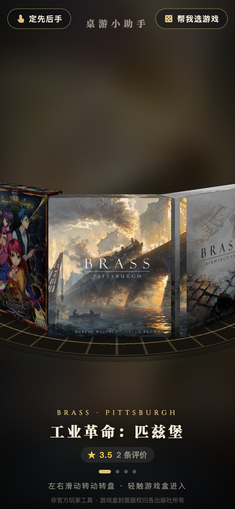
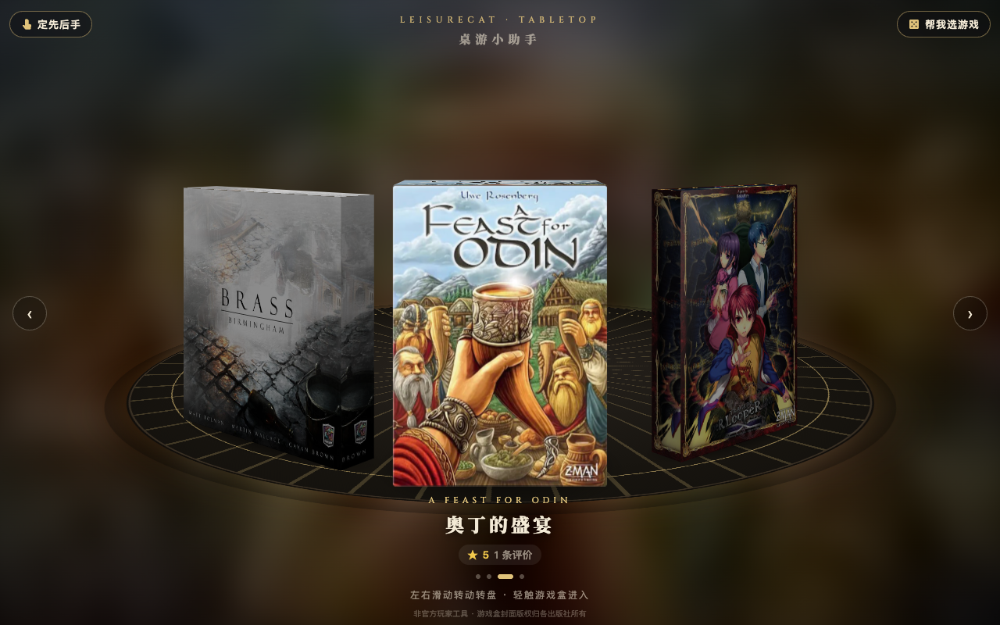

<div align="center">

# 桌游小助手

**线下开局、计分、规则问答，一桌人扫码同步**

所有桌游助手的总入口：用立体转盘选游戏，旁边配了“帮我选游戏”“定先后手”两个通用工具，还能看玩家评价。

**[立即使用 → boardgame.leisurecat.cloud](https://boardgame.leisurecat.cloud)**

 

</div>

---

## 已有的助手

| 游戏 | 地址 | 代码 |
|---|---|---|
| 工业革命：匹兹堡 | https://pgh.leisurecat.cloud | [brass-pittsburgh-helper](https://github.com/86777835/brass-pittsburgh-helper) |
| 工业革命：伯明翰 | https://bham.leisurecat.cloud | [brass-birmingham-helper](https://github.com/86777835/brass-birmingham-helper) |
| 奥丁的盛宴 | https://odin.leisurecat.cloud | [feast-for-odin-helper](https://github.com/86777835/feast-for-odin-helper) |
| 惨剧轮回 · 剧作家助手 | https://tl.leisurecat.cloud | [tragedy-looper-helper](https://github.com/86777835/tragedy-looper-helper) |
| 血染钟楼 | https://botc.leisurecat.cloud | [blood-on-the-clocktower-helper](https://github.com/86777835/blood-on-the-clocktower-helper) |
| 阿纳克遗迹 | https://arnak.leisurecat.cloud | [lost-ruins-of-arnak-helper](https://github.com/86777835/lost-ruins-of-arnak-helper) |
| 阿瓦隆 | https://avalon.leisurecat.cloud | [avalon-helper](https://github.com/86777835/avalon-helper) |

## 功能

- **立体转盘**：各游戏的官方盒封面做成立体盒子，摆在转盘上。左右滑动（电脑上可用方向键或滚轮）转动转盘，轻触正中的盒子，封面放大并虚化，然后进入对应的助手。
- **帮我选游戏**（右上角）：游戏库共 26 款，数据来自 BGG，有助手的可以直接进入。
  - 按条件选：选人数、时长、难度、类型，每款游戏得到一个 0–99 的推荐指数。
  - 随便来一个：随机抽一款。
  - 问 AI：用一句话描述这局的情况，AI 按推荐指数展示列表，首选默认展开。
  - 按条件直接展示列表，人数和助手范围为硬条件，其余条件影响推荐指数；只有随机使用抽盲盒动画。
- **定先后手**（左上角）：任何桌游都能用。
  - 手指轮盘：每人一根手指按住屏幕，人齐后按住 1.5 秒，光圈轮转，最后显示 1、2、3…
  - 随机排序：填好名字，像从袋子里摸棋子一样，一个个抽出顺序。
- **玩家评价**：每个助手的结算页都能给游戏打 1–5 星并写评论。首页游戏名下显示平均分和评价数，点开能看到星级分布和全部评论。
- **海报**：`海报/` 里有带二维码的总入口海报，2480×3720 高清版和手机版。源文件在 `海报/源文件/poster.html`。

## 技术实现

纯静态页面 + Cloudflare Worker，没有构建步骤，没有框架。

| 部分 | 说明 |
|---|---|
| `public/index.html` | 转盘首页：CSS 3D 盒子和转盘，拖动带惯性，进入时有放大虚化过渡 |
| `public/games.json` | 游戏库。带 `url` 的是有助手的游戏，会出现在转盘上；`box` 是真实盒子尺寸（cm） |
| `public/picker.js` | 帮我选游戏：推荐指数算法、抽盲盒动画 |
| `public/order.js` | 定先后手：多点触控的手指轮盘、袋子抽签 |
| `public/reviews.js` | 评价列表 |
| `src/worker.js` | `/api/reviews`：评价存在 `Reviews` Durable Object（SQLite）里，允许 `*.leisurecat.cloud` 跨域；`/api/pick`：AI 选游戏，先用 DeepSeek，不行再用 Workers AI 上的 Qwen，回答只能是游戏库里的游戏 |

### 评价接口

```
POST /api/reviews   { game, stars: 1-5, name, text, room }   同一局同一玩家再次提交会覆盖
GET  /api/reviews?game=pgh                                  → { avg, count, dist[5], items[] }
GET  /api/reviews                                           → { pgh: { avg, count }, ... }
```

## 本地开发与部署

图片缓存 7 天，部署时若替换同名图片，用户最多需要等待 7 天才能看到新图。

```bash
wrangler dev --port 8811     # 本地运行
wrangler deploy              # 部署
```

AI 选游戏要用 DeepSeek 时，运行 `wrangler secret put DEEPSEEK_API_KEY --name leisurecat-tabletop-hub` 填入密钥。没有密钥时只用 Workers AI。

## 测试

需要本机装有 Chrome，并执行 `npm i playwright-core`。

```bash
node tests/test_turntable.mjs http://localhost:8811/   # 转盘：滑动、方向键、点侧边、循环、进入、返回（不写数据，也可以对线上跑）
node tests/test_tools.mjs     http://localhost:8811/   # 评价、选游戏（AI 用模拟返回）、袋子抽签、三指轮盘（只能对本地跑，会写测试评价）
```

整个系列的约定和待办见 [docs/系列交接说明.md](docs/系列交接说明.md)。

## 声明

- 这是非官方的玩家工具，不提供游戏本体。
- 游戏名称、规则和游戏盒封面的权利归各原出版方所有；背景插画为原创生成。

## 总入口规则问答

右下角「问答」先在浏览器按游戏名和专属词匹配，再通过 `POST /api/ask` 的 Service Binding 交给对应站的 `/api/chat`。没有新增模型调用或密钥要求；原有「帮我选游戏」接口独立保留。

- `public/ask-router.js`：纯函数别名表、匹配与对话路由。唯一命中直接问；多个命中只列候选；没有命中列全部九款助手，追问沿用已选游戏。候选中有当前转盘游戏时默认高亮，但必须点击才发送。
- `public/ask.js`、`public/ask.css`：悬浮面板、示例、游戏标签与进入链接；切换游戏清空请求上下文，保留可见聊天记录并提示切换。流式 `reset` 清除旧内容，错误不进入上下文，不显示模型名；整次请求最多等 30 秒，缺失 `[DONE]` 的断流提示回答未完成。
- `/api/ask` 只接受游戏库中带 `url` 的 key，透传下游状态、响应头、流和访客 `cf-connecting-ip`。沙丘仅在最后一条用户消息前加版本说明；其余消息字段保持原样。输入上限 490 字，为下游的 500 字限制留出版本前缀。
- 未收录的 17 款只匹配游戏库中英文名称（中文括号内的别名也算名称），固定回复「这款还没有收录规则资料」，不请求接口。问题同时提及未收录游戏时也先明确资料缺失，不把它交给另一款助手编答。

别名来源是各站只读的 `tools/讲解稿.md` / `tools/faq.json`，另自动匹配 `games.json` 的完整中英文名：

| 游戏 | 别名词数 | 例子 |
|---|---:|---|
| 匹兹堡 | 5 | 石油城、重型火车、皇冠明珠 |
| 伯明翰 | 4 | 商人啤酒、农场酿酒厂 |
| 奥丁 | 5 | 维京、庭之广场、庭之惩罚 |
| 惨剧轮回 | 5 | 剧作家、轮回、不安限度 |
| 阿纳克 | 4 | 神像槽、恐惧卡 |
| 血染钟楼 | 6 | 说书人、魔典、幽灵票 |
| 阿瓦隆 | 6 | 梅林、刺客、派西维尔、湖中仙女 |
| 沙丘基础版 | 3 | 沙丘基础版、沙丘帝国基础版、Dune base |
| 沙丘起义 | 3 | 起义、Uprising、沙虫 |

回合、计分、领袖、角色、贷款、工人、煤、铁、间谍、神器、守卫等通用词不作为专属关键词；工业革命、Brass、运河只能缩小到匹兹堡和伯明翰。单说沙丘/Dune（含未注明版本的完整标题）列两版；明确基础/原版/base 或起义/沙虫后才确定版本。基础版和起义同时出现时仍请用户选。

### 本地 mock 联调（不会调用线上规则接口）

按 [Cloudflare 多 Worker 本地开发文档](https://developers.cloudflare.com/workers/local-development/multi-workers/) 的多 `-c` 方式启动；首个配置提供 HTTP 入口，其余八个 mock 配置使用真实 Worker 名以连接绑定，全部在本地运行：

```bash
ln -s /tmp/claude-501/pgh2/node_modules node_modules
wrangler dev --local --port 8811 \
  -c wrangler.jsonc \
  -c tests/mock/pgh.jsonc -c tests/mock/bham.jsonc \
  -c tests/mock/odin.jsonc -c tests/mock/tl.jsonc \
  -c tests/mock/arnak.jsonc -c tests/mock/botc.jsonc \
  -c tests/mock/avalon.jsonc -c tests/mock/dune.jsonc \
  -c tests/mock/ark.jsonc
```

另一终端运行：

```bash
mkdir -p shots /tmp/claude-501/codex_tasks/shots
node tests/test_ask_router.mjs
node tests/test_ask_api.mjs
node tests/test_ask_ui.mjs
node tests/test_turntable.mjs http://localhost:8811/
node tests/test_tools.mjs http://localhost:8811/
# 完成后在开发服务器终端 Ctrl-C，并删除临时依赖软链
rm node_modules
```

`tests/mock/worker.js` 返回固定 SSE，正文带 mock 的 game、最后问题、完整消息和收到的 IP（沙丘共享 mock 标记为 dune，通过问题前缀区分版本）。问题包含 `mock429` / `mock503` 模拟 HTTP 错误，`mockreset` 模拟部分回答后重置，`mockerror` 模拟流内错误，`mockdrop` 模拟半途结束、缺失完成标记，`mocktimeout` 模拟 31 秒无响应。浏览器断网使用 Playwright 拦截模拟。测试仅访问 localhost；原有 AI 选游戏测试拦截 `/api/pick`，不触发真实模型。

截图：`/tmp/claude-501/codex_tasks/shots/ask_*.png`，含 390/320 宽入口、欢迎页、直接回答、候选和未收录提示。
